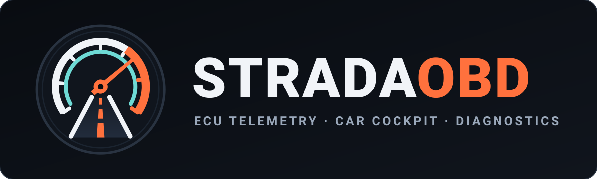

# StradaOBD — Telemetría ECU, Cockpit y Diagnosis para Android

Aplicación Android moderna (**StradaOBD**, desarrollada con **Jetpack Compose**, **Kotlin** y **Material 3**) para conectar adaptadores **ELM327** (Bluetooth SPP, WiFi TCP o Modo Simulación) en radios de coche Android y dispositivos móviles, y visualizar telemetría automotriz verificada en tiempo real.

Soporta importación de archivos CSV con PIDs específicos y fórmulas de cálculo compatibles con **Torque Pro**, perfil de vehículo sin estimaciones de telemetría, detección de sensores soportados por la centralita del coche y un **diseñador de cuadros de mando personalizados**.

## Rejilla fija de coche en 1.6.3

En **Paneles → Editar → Herramientas → Disposición de rejilla**, el modo coche
ofrece de **1 a 4 columnas** y **1 o 2 filas**: ocho combinaciones rectangulares,
más las dos variantes de indicador principal con dos laterales. Los nombres del
selector indican columnas y filas explícitamente.

La disposición elegida ocupa una sola pantalla. Cambiar de resolución, orientación
o tamaño de letra ajusta las celdas y sus cifras, sin cambiar columnas, filas ni
posiciones y sin repartir los instrumentos en páginas. Inicio y Paneles mantienen
su presentación sin desplazamiento vertical.

La rejilla de coche se guarda por panel, independientemente de la rejilla móvil,
y se conserva al cerrar la app, duplicar o exportar el diseño. Los paneles antiguos
más grandes usan como máximo 4 columnas y 2 filas en coche; las asignaciones que
quedan fuera de esas ocho posiciones siguen guardadas para el modo móvil.

`python3 scripts/revisar-rejilla-coche.py` selecciona disposiciones desde la interfaz,
comprueba el reinicio y verifica la geometría exacta de 4 columnas y 2 filas en ocho
configuraciones de pantalla. También comprueba que la rejilla móvil y sus ranuras
ocultas se conserven. Añade `--release-apk app/build/outputs/apk/release/app-release.apk`
para comprobar la APK final. Evidencias en `build/fixed-grid-review/`.

## Averías, perfiles y primer arranque en 1.6.2

- **Averías** tiene su propio acceso permanente en modo coche, junto a Inicio, Paneles
  y Menú. **Leer averías** permanece visible al recorrer los resultados. Un contador
  aparece cuando la consulta devuelve códigos; no se deducen averías de la falta de datos.
- Los filtros, el informe, los monitores, los datos congelados y el borrado se abren
  desde **Opciones de averías**. El borrado conserva su confirmación y la comprobación
  de motor parado.
- **Menú → Vehículo** usa el mismo estilo de tarjetas grandes: perfil activo, garaje,
  nueva ficha, sensores de la ECU y privacidad. Permite consultar, editar, cambiar
  y eliminar perfiles (se conserva el último).
- Si no existe ningún perfil guardado, el arranque abre un asistente de una pregunta
  por pantalla. Solicita nombre, año, combustible, cilindrada, depósito, peso, potencia,
  par y régimen máximo; también permite revisar eficiencia, ajuste de presión y sensores.
  Los comandos del adaptador son opcionales y vacíos usan la configuración automática.
  La ficha se valida antes de guardar. No se crea un vehículo de ejemplo.
- La entrada numérica tiene un teclado propio con teclas de al menos 76 dp: dos filas
  en radios horizontales y cuatro en ventanas estrechas. Anterior, Siguiente y Guardar
  permanecen accesibles. Los perfiles ya guardados se conservan.

`python3 scripts/revisar-perfil-coche.py` comprueba el primer arranque, todos los
campos, la persistencia, cancelación sin cambios y el acceso a Averías en ocho
configuraciones: 800×480, 1024×600, 1280×720, 1280×480, 1920×720, distintas densidades,
vertical 400×800 y letra al 150 %. Usa únicamente un emulador y restaura sus datos
y configuración. Evidencias en `build/vehicle-review/`.

## Interfaz para coche en 1.6.1

El **modo coche** es la presentación predeterminada, también al actualizar una
instalación anterior. Se puede cambiar en **Menú → Ajustes → Pantalla y lectura →
Modo móvil**. La elección se guarda al cerrar la aplicación; los vehículos,
indicadores, sensores y conexiones son compartidos entre ambas presentaciones.
En modo móvil, el selector está en **Ajustes → General**.

- Cuatro accesos permanentes: **Inicio**, **Paneles**, **Averías** y **Menú**. En pantallas
  horizontales se usa una barra lateral; en vertical, una barra inferior que se divide
  en dos filas si el ancho no permite mantener botones grandes.
- Cuadro de conducción con velocidad, RPM, refrigerante y voltaje. En radios de
  menor altura, la velocidad ocupa el lado izquierdo y las otras lecturas se
  agrupan a la derecha. Los valores sin lectura válida se muestran como `—`.
- Objetivos táctiles de **76 dp** en botones, iconos, pestañas y opciones; texto
  habitual de **24–32 sp**, iconos de 32 dp y cifras principales de hasta 144 sp.
  Se respeta el tamaño de letra elegido en Android.
- Menús con tarjetas grandes para vehículo, sensores, averías, conexión,
  grabación y ajustes. Conexión se divide en Bluetooth, WiFi, estado y registro.
  El botón Atrás vuelve por los niveles abiertos.
- **Inicio y Paneles sin scroll vertical en modo coche.** Inicio mantiene sus cuatro
  lecturas en una composición limitada al visor. Desde 1.6.3, Paneles conserva exactamente
  la rejilla de coche elegida, limitada a cuatro columnas y dos filas. La rejilla
  móvil y las asignaciones que queden fuera del panel de coche se conservan.
- Estilo de cockpit con superficies planas, acentos azules, navegación redondeada,
  cifras más limpias e instrumentos de arco sin graduaciones diminutas. Los colores,
  escalas y tipos de indicador personalizados se conservan. El historial sigue siendo
  real en los gráficos. El nombre del panel abre un selector si hay varios paneles.
  Los controles manuales del simulador permanecen en la presentación móvil.
- El editor de paneles abre sus herramientas en un menú grande. Tocar una ranura
  durante la edición abre sus acciones. **Listo** regresa a la lectura.

El diseño adapta las recomendaciones de
[Android for Cars](https://developers.google.com/cars/design/design-foundations/visual-principles)
y su [escala tipográfica](https://developers.google.com/cars/design/android-auto/design-system/typography),
con accesos directos inspirados en
[BMW QuickSelect](https://faq.bmwusa.com/s/article/FAQ-How-to-Use-the-New-BMW-Operating-System-85-with-QuickSelect-BMW-USA-7dH8R)
y [Mercedes MBUX](https://group.mercedes-benz.com/technology/digitalisation/connectivity/mbux-interior-assist.html).
Es una interfaz para ejecutar la app Android en la radio; no añade proyección
ni integración con el catálogo de aplicaciones de Android Auto. La edición,
configuración, terminal y borrado de averías se deben usar con el coche detenido.

Para repetir las comprobaciones en un emulador:
`python3 scripts/revisar-modo-coche.py --serial emulator-5554`.
Captura radios de 800×480 y 1024×600 con distintas densidades, vertical y letra
al 150 %, comprueba navegación, herramientas, filtros, cambio de modo y
persistencia, y restaura las preferencias y la configuración de pantalla.
Las evidencias se guardan en `build/car-review/`. Añade `--simulate` para revisar
las lecturas con datos de prueba; también se restaura esta preferencia al terminar.
La verificación de páginas es `python3 scripts/revisar-paneles-sin-scroll.py`:
comprueba que los gestos verticales no desplazan las lecturas y recorre las ocho
combinaciones rectangulares en cinco configuraciones. `--quick` revisa las pantallas,
el editor y que las unidades se vean completas sin recorrer las ocho combinaciones.
Las capturas e informes quedan en `build/cockpit-review/`; se restauran los datos del
emulador al terminar.

## Grabación y segundo plano en 1.5.0

En **Ajustes → Grabación**, pulsa **Iniciar grabación** con el adaptador conectado.
También se pueden grabar sesiones de simulación, identificadas en pantalla,
notificación y CSV. **Detener grabación** cierra la sesión para exportarla mediante
el selector de archivos de Android. Eliminar una sesión requiere confirmación y
no elimina los CSV exportados.

La opción **Lectura en segundo plano** está activada por defecto. Mantiene la
misma conexión y los sensores al cambiar de app, apagar la pantalla o cerrar la
actividad. Una notificación persistente permite volver a la aplicación, detener
la grabación o detener toda la lectura. Concede el permiso de notificaciones
para ver estos controles. Si se deniega, Android puede mantener el servicio,
pero no mostrar su notificación en la barra. Sin segundo plano y sin grabación,
salir de la app desconecta el enlace; volver reanuda el adaptador seleccionado.

Mientras se graba se consultan **todos los sensores habilitados**, incluidos los
que no aparecen en pantalla; se conserva el modo de lectura elegido y se recupera
al detener la sesión. Esto puede reducir la frecuencia de cada sensor. Fuera de
una grabación se mantiene el modo elegido mientras la app está visible; en segundo
plano se consultan todos los sensores habilitados, aunque se haya salido desde Ajustes. Los avisos siguen evaluándose en el servicio; su presentación
continúa siendo visual dentro de la app.

Cada lectura válida recibida se escribe una vez, con valor `Double` y sin recopilar
copias del estado de la interfaz. El CSV UTF-8 usa coma como separador y punto
decimal. Incluye hora UTC, milisegundos, tiempo monotónico desde el inicio, sesión,
vehículo, origen, adaptador, ID y nombre del sensor, comando, cabecera, fórmula,
valor, unidad y estado. Las filas `EVENT` describen inicio, cierre, cortes y
reconexiones. Las filas `SENSOR` contienen únicamente lecturas nuevas; no se
inventan valores durante una pérdida de conexión ni se rellenan datos caducados.

La escritura se realiza en IO y se vacía/sincroniza aproximadamente cada segundo.
Las sesiones quedan en el almacenamiento privado del dispositivo, excluidas de
la copia automática de Android. Cambiar vehículo, configuración del vehículo,
adaptador o modo simulación cierra primero la sesión actual. Una reconexión al
mismo adaptador mantiene la sesión y registra el corte. Un error de almacenamiento
detiene la grabación y muestra el fallo, manteniendo disponible la lectura OBD.

El servicio usa `connectedDevice`, un bloqueo de CPU temporal renovable y, para
WiFi, un bloqueo del enlace; libera estos recursos al detener la lectura. Sigue las
[reglas de servicios de Android](https://developer.android.com/develop/background-work/services/fgs/service-types#connected-device).
No arranca al encender el teléfono ni reinicia una grabación cuando Android termina
el proceso. Al volver se recuperan las filas completas, se elimina una cola CSV
incompleta y la sesión se identifica como **Interrumpida**. La lectura real debe
validarse también con el adaptador y la política de batería de cada radio.

`python3 scripts/revisar-grabacion.py --serial emulator-5560` prueba la lectura TCP,
grabar al salir de la app y apagar pantalla, reconexión, controles de notificación,
exportación CSV, recuperación y tamaños de pantalla. Requiere el AVD temporal
`TorqueRecordingChecks`, restaura sus datos y guarda evidencias en
`build/recording-review/`. Las pruebas unitarias cubren muestras exactas, sensores
ocultos, recuperación CSV, concurrencia, fuentes separadas y fallos de disco.

## Avisos configurables en 1.4.0

**Ajustes → Avisos → Añadir aviso** permite elegir un sensor de la biblioteca,
un límite inferior, uno superior o ambos, y una persistencia de 0 a 3600 segundos.
Los límites usan la unidad del sensor y aceptan punto o coma decimal. El valor
debe ser estrictamente menor o mayor que el límite; la igualdad está dentro del
rango. Cero segundos activa el aviso con la primera lectura que excede el límite.
Con persistencia, se necesitan muestras válidas que sigan excediendo el mismo
límite durante el tiempo configurado; esperar sobre una única muestra no lo activa.

Las reglas se guardan **por vehículo**, identifican el sensor por su ID y permiten
editar, activar/desactivar o eliminar con confirmación. No hay límites precargados.
Un sensor desactivado no se habilita automáticamente: su tarjeta ofrece **Activar
sensor**. Los sensores con avisos habilitados se consultan aunque estén fuera de
pantalla, en todos los modos de lectura; esto puede reducir la velocidad de otros
indicadores. La vigilancia continúa en segundo plano mientras el servicio de lectura esté activo.

Una franja **AVISO DE LA APP** muestra los avisos activos en todas las secciones,
también a pantalla completa. Al pulsarla se ven todos los valores y límites.
La simulación lleva su identificación explícita. Son avisos visuales configurados
por el usuario, no testigos ni diagnósticos deducidos del coche; no emiten sonidos
ni notificaciones fuera de la app.

El aviso termina al regresar dentro de límites. Si hay una respuesta inválida,
un campo ausente, un dato caducado, una desconexión, una pausa o un cambio de
vehículo, se reinicia la persistencia. La tarjeta comunica el motivo de falta de
vigilancia. Un sensor eliminado o con unidad distinta requiere revisar la regla;
no se sustituye por otro con el mismo nombre. Editar la regla reinicia su espera;
redefinir el PID invalida la lectura anterior y requiere datos nuevos. Los estados activos y temporizadores
no se recuperan tras un reinicio: las reglas esperan nuevas lecturas.

`python3 scripts/revisar-avisos.py --serial emulator-5560` comprueba creación,
validación, persistencia, límites inferiores con coma decimal, varios avisos,
separación por vehículo, edición, desactivación, eliminación, el cuadro a pantalla
completa y los formularios en radio 1024×600 y vertical con letra grande. Usa un
emulador dedicado y simulación, restaura preferencias y pantalla y guarda las
evidencias en `build/alerts-review/`. Las pruebas unitarias cubren temporización,
identidad, datos inválidos/caducados, pausa y vigilancia fuera de pantalla.

## Editor de cuadros ampliado en 1.3.0

**A Medida → Editar → Herramientas** ofrece 18 disposiciones, desde un único
indicador hasta una matriz de 24 ranuras (4 filas × 6 columnas), además de los dos
diseños con indicador principal y laterales. **Presentación compacta** reduce los
márgenes y muestra tarjetas de título, valor y unidad/estado. **Pantalla completa**
oculta las barras de navegación de la app; conserva el estado de conexión o la
identificación de simulación y un botón de salida. También se sale con Atrás.

En modo móvil, las columnas se adaptan al ancho y al tamaño de letra. Si el conjunto no cabe con
cifras legibles, se permite desplazamiento vertical. En modo coche, la disposición
elegida permanece fija, con un máximo de cuatro columnas y dos filas, sin scroll
vertical ni páginas internas de indicadores. Reducir la rejilla conserva
las asignaciones de las ranuras ocultas para recuperarlas al ampliarla; esas
ranuras no generan consultas en el modo «Solo pantalla».

En ventanas estrechas, el formulario separa «Sensor» y «Apariencia» mediante
accesos directos. El menú de cada indicador permite editar tipo, sensor, título y color; elegir
decimales automáticos o de 0 a 4; y definir mínimo y máximo de su escala visual.
Las escalas cambian el dibujo, sin alterar la lectura recibida. Los estados
enumerados conservan sus etiquetas. **Mover / intercambiar** cambia dos posiciones
o mueve a un hueco; **Duplicar indicador** crea una copia independiente en una
ranura vacía. **Añadir varios indicadores** permite buscar y seleccionar sensores
para rellenar los huecos con tarjetas compactas, sin sustituir indicadores.

Puedes duplicar una pestaña completa o eliminarla tras confirmación. La última
pestaña se conserva. **Importar / exportar diseños** guarda la pestaña activa o
todas en JSON mediante el selector de archivos de Android. La importación muestra
una revisión y añade pestañas nuevas con identidades independientes. Incluye
rejilla, densidad, ranuras visibles y ocultas, vínculo al sensor, tipo, título,
color, decimales y escala; no incluye lecturas, conexiones ni definiciones de PIDs.
Si falta un sensor, el indicador lo comunica y se puede reasignar en el editor.
Los archivos usan `format: StradaOBD.designs` (compatible con `TorqueOBD2Dash.designs`), versión 1, y un límite de 2 MB.
Un archivo inválido no cambia los cuadros existentes.

`python3 scripts/revisar-editor-funciones.py` verifica las operaciones del editor,
la persistencia después de reiniciar y la exportación/importación real por el
selector de archivos, con datos de simulación. Guarda evidencias en
`build/editor-expanded/functions/` y restaura las preferencias originales.

`python3 scripts/revisar-editor-release.py` comprueba con el APK de distribución
una escala de voltaje de 13,6 a 14,4 V, tres decimales y 24 ranuras con lecturas
simuladas visibles en una radio 1024×600 (densidad 240 dpi, letra al 100 %).
Restaura las preferencias y deja instalado el APK release. Las capturas y el
resultado quedan en `build/editor-expanded/release/`.

## Diagnóstico de averías en 1.2.0

La sección **Averías** consulta el OBD estándar de emisiones mediante ELM327 Bluetooth
o WiFi: modos 03 (confirmados), 07 (pendientes) y 0A (permanentes). Conserva la
dirección de cada ECU, interpreta códigos P/C/B/U y muestra los modos sin soporte,
sin datos o con respuestas inválidas. Una respuesta válida sin códigos se distingue
de una consulta que no pudo completarse. No consulta por estos modos los módulos
ABS, airbag u otros sistemas propietarios del fabricante.

Incluye el estado del testigo MIL y los monitores desde el último borrado (0101),
datos congelados del cuadro estándar 0 cuando existe (modo 02), búsqueda, detalle
de cada código y un informe TXT que se puede guardar o copiar. Cada informe lleva
vehículo, adaptador, fecha, condición de simulación y respuestas originales. Es una
captura: al cambiar de conexión o perfil se invalida. El catálogo funciona sin
conexión; los códigos habituales tienen traducción en español y el resto de las
definiciones genéricas disponibles se muestra en inglés. Los códigos propietarios
no reciben una definición genérica por suposición. Fuente, licencia MIT y catálogo
están en `app/src/main/assets/dtc/`.

**Borrar averías** necesita una captura de la conexión actual y confirmación expresa
dentro de la app. Explica que el modo 04 borra códigos almacenados y pendientes,
datos congelados y estados de monitores; requiere contacto encendido y motor
apagado. Si la ECU comunica RPM positivas, no se envía 04. La respuesta 44 confirma
qué ECU aceptó el borrado y una consulta nueva muestra el estado posterior; una
respuesta ausente o parcial no se presenta como borrado completado. Los códigos
permanentes solo los elimina la ECU tras verificar la reparación.

Las transacciones DTC se serializan con las lecturas de sensores, el escaneo y el
terminal. Usan la dirección funcional estándar para obtener todas las respuestas
de emisiones, sin heredar cabeceras de sensores propietarios; al terminar o cancelar
se restauran la inicialización del perfil y el formato del adaptador. El simulador
incluye averías ficticias, monitores y datos congelados, con permanentes que quedan
después del borrado, y lo indica tanto en pantalla como en el informe.

`python3 scripts/revisar-dtc.py` verifica en un emulador dedicado la comunicación TCP
con un ELM de prueba: varios módulos, los tres modos, descripción, datos congelados,
copia del informe, cancelación del borrado, respuestas inválidas, modos sin soporte,
bloqueo con motor en marcha y permanentes después del borrado. Guarda capturas y
resultados en `build/dtc-review/` y restaura las preferencias originales. Las pruebas
unitarias cubren también ISO-TP multitrama, formatos CAN de 11/29 bits, protocolos
anteriores a CAN, cancelación y autorización por sesión. Con
`--release-apk app/build/outputs/apk/release/app-release.apk` comprueba el instalador
release y lo deja instalado, usando debug solo para respaldar/restaurar las
preferencias del emulador. Estas pruebas no certifican
un ELM físico ni una ECU concreta.

## Identidad de sensores y estados de lectura en 1.1.4

Las lecturas, históricos, selección de sensores visibles y ranuras de los cuadros
utilizan el ID del PID. Dos sensores con el mismo nombre corto pueden tener
comandos, ecuaciones o cabeceras de ECU distintos y conservar lecturas independientes.
Una cabecera vacía usa la configuración del perfil, sin heredar la del sensor anterior;
al regresar a la cabecera automática se restauran los ajustes del adaptador. Los mapas
de soporte de una ECU no se aplican a sensores dirigidos explícitamente a otra.
Los PIDs CSV tienen IDs reproducibles; las definiciones importadas y su activación
se guardan entre aperturas. La compatibilidad se vuelve a comprobar en cada conexión.
Los cuadros antiguos se migran sin cambiar sus ranuras ni sus títulos: una referencia
por nombre se vincula cuando es única, o cuando su título identifica una definición
única. Una referencia ambigua muestra «Sensor no encontrado» para seleccionarla de
nuevo. Un ID ya guardado nunca se sustituye por otro sensor con el mismo nombre.

El cuadro Deportivo y el cuadro inicial A Medida usan RPM, velocidad, refrigerante
y voltaje de la ECU. Las plantillas y el selector del editor omiten sensores que la
ECU ha confirmado como incompatibles; los aún no comprobados mantienen esa indicación.
Los cuadros personalizados existentes conservan sus sensores, incluidos los de
potencia/par que se hayan configurado expresamente.

Los valores ausentes mantienen «—» y muestran el motivo tanto en Sensores como en
las ranuras del cuadro: «Pendiente de consultar», «Sin respuesta», «Respuesta inválida»,
«Dato caducado», «Sensor incompatible» o «Campo no disponible». Los detalles del
sensor explican cada estado. NO DATA, una trama truncada y un campo opcional ausente
no demuestran incompatibilidad. Los fallos temporales se reintentan; los comandos
sin respuesta o sin una trama válida tienen un margen de un segundo antes del
siguiente intento para no saturar el adaptador. Una lectura válida elimina el error;
los datos caducan tras cinco segundos sin actualización. La simulación sigue separada
y etiquetada.

`python3 scripts/revisar-identidad.py --serial emulator-5554` comprueba en un emulador
de desarrollo los indicadores iniciales, dos sensores homónimos en distintas ECU,
los motivos de ausencia, la migración y la persistencia tras reiniciar usando un
ELM WiFi local de prueba. Instala el APK debug, respalda y restaura las preferencias
del emulador y guarda capturas y resultados en `build/identity-review/`. No certifica
la correspondencia de PIDs propietarios con un vehículo físico.

---

## Instalación en una radio Android

- Nivel mínimo: **Android 6 (API 23)**, para cubrir también radios con un sistema anterior al indicado por su interfaz. Android 10 sigue siendo compatible.
- Genera el instalador con `./gradlew :app:assembleRelease` (`app/build/outputs/apk/release/app-release.apk`) o el bundle para Google Play Store con `./gradlew :app:bundleRelease` (`app/build/outputs/bundle/release/app-release.aab`).
- El APK y el AAB incluyen firmas **v1 y v2** usando la clave de producción configurada en `keystore.properties` (`upload-keystore.jks`), con respaldo automático a la clave `debug` únicamente en entornos de desarrollo sin keystore configurado.
- Incluye las arquitecturas ARM de 32 y 64 bits (además de x86/x86_64), librerías nativas comprimidas con extracción durante la instalación e iconos para Android anterior a 8.
- Copia el archivo completo a la memoria interna de la radio e instálalo desde su gestor de archivos, permitiendo instalar aplicaciones de esa fuente cuando Android lo solicite.

Si aparece «Se ha producido un error al analizar el paquete», comprueba que estás usando el APK recién generado y que la copia tiene el mismo tamaño que el original. La firma v1 amplía la compatibilidad, pero el APK anterior ya tenía una firma v2 válida para Android 10: no confirma por sí sola la causa del error.

### Prueba rápida en la radio (5 minutos)

1. Copia el APK nuevo a la memoria interna e instálalo. Si se rechaza, fotografía el mensaje exacto; no borres la instalación anterior ni sus datos como primer paso.
2. Abre la app: debe indicar **Sin conexión** y no generar datos simulados. Activa **Ajustes → General → Modo simulación** para comprobar RPM y velocidad; desactívalo al terminar. Prueba el formato horizontal y vuelve a abrir la app tras salir a la pantalla de inicio de la radio.
3. En **Ajustes → Conexión**, fotografía la versión de la app, Android, **API** y arquitecturas que aparecen arriba. En Android 10 no se solicita ubicación para listar dispositivos ya emparejados.
4. Con contacto dado, empareja el ELM327 desde Ajustes de Android y vuelve a **Ajustes → Conexión**. Debe aparecer automáticamente. Si solo aparece en la app de fábrica, puede que esa radio no exponga Bluetooth SPP a otras apps: prueba un adaptador WiFi si dispones de uno.
5. Conecta y verifica RPM con el motor en marcha. Si falla, fotografía el **Registro de diagnóstico** o usa su botón de copiar. En **Ajustes → Terminal**, `ATI` comprueba el adaptador y `0100` comprueba la respuesta de la ECU. El perfil inicial es Honda i-DTEC; para otro vehículo configura sus comandos de inicialización en **Vehículo** (déjalos vacíos para usar la selección automática de protocolo) y reconecta.

Si puedes conectar un ordenador por ADB, ejecuta `bash scripts/probar-radio.sh` (o añade la ruta del APK y el identificador ADB de la radio). Instala sin borrar datos, intenta abrir la app y guarda la API real, arquitecturas, resultado de instalación y errores de arranque en `build/radio-check/`. Si falla al instalar, conserva ese resultado: distingue versión incompatible, firma distinta, espacio insuficiente y APK incompleto.

Comprobaciones manuales equivalentes: `adb install -r app/build/outputs/apk/release/app-release.apk` muestra el motivo del rechazo y `adb shell getprop ro.build.version.sdk` confirma el nivel de Android real (debe ser 23 o superior).

---

## Diseño racing 1.1.1

Las pantallas comparten ahora una interfaz en grafito con acentos naranja, tipografía de cifras grandes y paneles de telemetría. En horizontal, la navegación ocupa una barra lateral; en vertical, aparece abajo y se desplaza para mantener visible la sección seleccionada.

El cuadro Deportivo conserva el antiguo HUD: velocidad digital grande, luces de cambio de marcha, gráficos históricos de RPM y velocidad y acentos racing. Las tarjetas de potencia, par y marcha indican «—» sin un PID validado. El anterior cuadro Deportivo se ha retirado. Los cuadros pasan de columnas a filas cuando es necesario, ajustan las cifras al ancho disponible y permiten desplazarse en ventanas demasiado pequeñas para mantener la legibilidad. El editor de cuadros, garaje, monitor de sensores, conexión y terminal mantienen sus controles con el mismo estilo visual.

### Comprobar el diseño en un emulador

`scripts/revisar-diseno.py` captura las cinco secciones principales y las tres pestañas de Ajustes en distintas resoluciones y tamaños de letra. Ejecuta `python3 scripts/revisar-diseno.py --serial emulator-5556 --action matrix` sobre un **emulador dedicado a pruebas**: cambia su resolución, densidad, orientación y tamaño de letra. Las capturas, jerarquías y datos de cada prueba quedan en `build/layout-review/`. Puedes limitar los casos con `--scenes pixel-landscape radio-800 portrait-400 large-text`.

El editor también adapta sus ventanas al área visible y al teclado. En pantallas estrechas, las ranuras personalizadas se reorganizan sin cambiar sus sensores ni la configuración guardada.

La revisión de 1.3.0 comprobó las 18 rejillas en presentación normal sobre
800×480 y la rejilla de 24 ranuras en presentación compacta en diez escenarios:
radios 800×480, 1024×600 y 1280×720; ventanas horizontales 640×360 y 480×272;
verticales 360×640 y 400×800; y letra al 150 % y 200 %. Las capturas, jerarquías
y resultados quedan en `build/editor-expanded/all-grids/`, `resolutions/` y
`resolutions-small/`. La pantalla completa muestra 24 ranuras a la vez en
1024×600 con 240 dpi y letra al 100 %. Si la ventana o la letra impiden mantener
la legibilidad, las ranuras restantes siguen accesibles mediante desplazamiento.

`python3 scripts/revisar-editor.py --serial emulator-5554` comprueba las 18 rejillas en diez configuraciones de pantalla, incluyendo radios, vertical, ventanas pequeñas y letra al 150 % y 200 %. Verifica que editar conserve la geometría, que todas las ranuras sean visibles o accesibles al desplazar y que los menús y el campo del nombre sigan disponibles. Guarda capturas y un informe en `build/editor-review/` y restaura los datos y ajustes originales del emulador. Se pueden limitar los casos con `--scenes radio-1024 portrait-360 --layouts 2x2 2x3`. Añade `--density compact --fullscreen` para revisar la presentación compacta y la pantalla completa; `--skip-dialogs` limita la prueba a los cuadros.

## Lectura OBD optimizada en 1.1.2

El ciclo de lectura envía la siguiente consulta al recibir el prompt de fin de respuesta del ELM327, sin la antigua pausa fija de 30 ms. Bluetooth y WiFi comprueban la llegada de datos cada 2 ms; WiFi también desactiva Nagle y activa el ajuste automático de tiempos `AT AT1`, igual que Bluetooth. Se mantienen los límites de espera para detectar un enlace perdido y se espera la respuesta completa, incluidas las tramas multilínea del DPF.

Los sensores que comparten comando y cabecera de ECU reutilizan una respuesta durante la misma vuelta. Los ocho sensores Honda que usan `222512` requieren una sola consulta en lugar de ocho. La siguiente vuelta vuelve a consultar la ECU: los datos no se conservan entre vueltas. El escaneo de compatibilidad también evita repetir el mismo comando extendido. Las estimaciones `CALC_HP`/`CALC_TORQUE` se han eliminado; nunca generan lecturas ni se envían al adaptador.

La cifra de **Ajustes → Conexión → Consultas al adaptador** cuenta consultas de datos reales por segundo, no la frecuencia individual de cada sensor. Para comparar con Torque Pro, activa los mismos sensores y utiliza el mismo vehículo y adaptador. Prueba primero RPM y velocidad y luego añade los sensores DPF. La frecuencia final depende de los tiempos de respuesta del adaptador y de la ECU; las pruebas automatizadas comprueban la reutilización de respuestas y la comunicación, pero no miden la frecuencia del ELM327 físico.

## Selección de sensores por pantalla en 1.1.3

En **Ajustes → General → Lectura de sensores** puedes elegir:

- **Solo pantalla** (predeterminado): consulta únicamente lo que necesita la pantalla abierta. Deportivo usa RPM y velocidad; potencia y par requieren un PID real explícito. El cuadro personalizado sigue las ranuras de la pestaña activa y su diseño actual, no los indicadores de otras pestañas ni los guardados fuera de ese diseño.
- **Equilibrado**: mantiene la misma prioridad para la pantalla y añade RPM, velocidad, refrigerante y voltaje de fondo. Las consultas adicionales se turnan con un presupuesto global de una cada dos segundos como máximo, sin volver a consultar un dato que ya se lee para la pantalla.
- **Todos los habilitados**: conserva la lectura continua de toda la selección de PIDs.

**Sensores** y **Vehículo → Sensores** consultan los sensores habilitados de las filas visibles al desplazarse o filtrar. La lista incluye toda la biblioteca, aunque aún no haya lectura; el signo «—» indica que no hay un dato actual válido. Las pantallas de configuración, conexión, ajustes y terminal no generan lecturas periódicas en «Solo pantalla». Los comandos manuales de terminal siguen funcionando.

No se añaden consultas para aproximar potencia, par ni marcha. Las ecuaciones de sensores que comparten una trama se actualizan juntas, sin consultas adicionales. Al cambiar de pantalla termina la consulta que esté en curso y se aplica la nueva selección.

Los modos ligeros no prueban toda la biblioteca de PIDs extendidos al conectar. Detectan los mapas estándar y comprueban los extendidos cuando su pantalla los necesita. **Vehículo → Escanear ECU** permite solicitar expresamente un escaneo completo. Los avisos de sensores que no se consultan no se muestran en la cabecera hasta que vuelvan a formar parte de la selección. La elección del modo se guarda entre aperturas.

---

## 🚀 Nuevas Funcionalidades Agregadas

### 1. 🚗 Perfil del Vehículo
- Permite configurar los parámetros del coche necesarios para los modelos matemáticos y cálculos de diagnóstico:
  - **Cilindrada del motor (Litros)**: ej. 2.2L, 2.0L, 1.6L (dato de ficha; no genera telemetría).
  - **Capacidad del depósito de combustible (Litros)**: ej. 50L (para cálculo exacto de litros restantes y autonomía en km).
  - **Peso del vehículo en vacío (kg)**: ej. 1450 kg (dato de ficha; no genera potencia ni par).
  - **Tipo de combustible**: Diésel, Gasolina (E5/E10), GLP / Autogas, Híbrido (con sus densidades y ratios estequiométricos AFR específicos).
  - **Régimen máximo (Redline RPM)**: ej. 5000 RPM para diésel, 6500+ para gasolina.
  - **Eficiencia volumétrica del motor (%)**: ej. 85%.
  - **Plantillas rápidas preconfiguradas**: Honda 2.2 i-DTEC, VAG 2.0 TDI, Gasolina 1.6 Turbo.

### 2. 🔍 Detección y Filtrado de Sensores Soportados por la ECU
- En función del coche conectado, hay parámetros que están o no disponibles en la centralita.
- **Escaneo activo de compatibilidad**:
  - Detección de mapas de bits de PIDs soportados estándar (SAE J1979 PIDs `0100`, `0120`, `0140`, `0160`).
  - Detección de respuestas para PIDs extendidos Modo 22 (distinguiendo entre respuestas positivas `62...` y respuestas no soportadas `NO DATA`, `ERROR`, `7F 22`).
- **Filtro dinámico de visualización**:
  - Interruptor: *"Mostrar únicamente los sensores soportados por el coche"*.
  - Oculta automáticamente indicadores y datos en blanco en los cuadros de mandos si la centralita del coche no dispone de ese sensor.

### 3. 🎨 Diseñador de Dashboards Personalizados (*A Medida*)
- Crea tu propio cuadro de mandos combinando los sensores que tú elijas:
  - **Tipos de Indicador**:
    1. *Reloj Analógico con Aguja*: Dial circular deportivo con arco degradado y display LCD integrado.
    2. *Display Digital Grande*: Números de gran visibilidad para circuito o conducción nocturna.
    3. *Barra de Nivel Horizontal*: Barra de progreso con lecturas numéricas y unidades.
    4. *Gráfico Histórico en Tiempo Real*: Trazado continuo Sparkline de telemetría.
    5. *Tarjeta Compacta*: Vista rápida minimalista.
  - **Disposición ajustable**: En coche, elige entre ocho rejillas de hasta ocho indicadores y dos diseños con indicador principal y laterales. En móvil, hay 19 disposiciones de hasta 24 indicadores, con presentación normal o compacta y pantalla completa.
  - **Modo Edición interactivo**: Edita estilos, escalas y decimales; añade sensores individualmente o en grupo; mueve, intercambia, duplica o vacía ranuras. Duplica y elimina pestañas e intercambia diseños en JSON.
  - **Persistencia**: La distribución diseñada se guarda en el dispositivo para que esté lista cada vez que abras la app.

---

## 📊 Cuadros de Mandos Disponibles

1. 🏁 **Deportivo**: Antiguo HUD, con velocímetro digital grande, marcha sin dato («—», no se estima), luces LED secuenciales de cambio, gráficos históricos y un toque racing en los números y el panel.
2. 🎨 **A Medida (Personalizado)**: Varios dashboards en pestañas superiores. Pulsa **+** para crear una pestaña con nombre y rejilla propia; toca su nombre o desliza el dash para cambiar entre ellas. **Editar** muestra el botón de herramientas en la misma barra superior: rejilla, indicadores, plantillas, nombre y **Ordenar**. Cada indicador tiene un menú para cambiarlo o vaciar su ranura. La rejilla mantiene su geometría al editar, usa lecturas compactas en celdas pequeñas y muestra una barra de desplazamiento cuando requiere más espacio. Las flechas de Ordenar cambian la posición de cada pestaña conservando la activa. Los nombres, el orden, la selección, los indicadores y las rejillas se guardan entre sesiones. La configuración anterior se conserva en la primera pestaña.
3. 📋 **Perfil Coche**: Configuración del vehículo y escáner de sensores soportados.
4. 📊 **Sensores**: Monitor e importador de PIDs unificados. Filas compactas con activación directa, valor, unidad y estado; hasta tres columnas según el ancho y tamaño de letra. Búsqueda y filtros por categoría, activos, compatibles o lecturas disponibles. El menú **Importar / catálogo** permite abrir o pegar CSV de PIDs extendidos y cargar conjuntos de fabricante, Honda i-DTEC u OBD estándar; tocar una fila abre sus detalles.
5. ⚙️ **Ajustes**: Un único acceso con las pestañas **General** (modo simulación y lectura de sensores), **Conexión** (Bluetooth SPP, búsqueda de adaptadores y WiFi TCP) y **Terminal** (comandos AT y consultas al ELM327).

## Conexión automática y simulación

La primera conexión se selecciona en **Ajustes → Conexión**. La app guarda el último adaptador Bluetooth o WiFi conectado correctamente y, en las siguientes aperturas, intenta enlazarlo automáticamente. Si no está disponible o se pierde el enlace, reintenta sin límite, con una espera de hasta ocho segundos entre intentos. También espera a que se concedan los permisos o se active Bluetooth. Puedes seleccionar otro adaptador durante los reintentos; su conexión sustituye la anterior y se recuerda cuando conecta correctamente.

**Buscar adaptadores cercanos** añade los dispositivos detectados a los ya emparejados. La búsqueda pide permisos adicionales solo al usarla (ubicación en Android 6–11, dispositivos cercanos en Android 12+); la reconexión al dispositivo recordado no necesita escaneo. Para emparejar un adaptador nuevo, Android puede solicitar su PIN. También hay un acceso permanente a los ajustes Bluetooth del sistema.

**Desconectar** o **Detener reconexión** suspende los intentos durante esa sesión. Se reanudan al seleccionar un adaptador o al abrir de nuevo la app. La simulación nunca se activa por falta de OBD: solo mediante **Ajustes → General → Modo simulación**, cuya elección se conserva. Al desactivarla se intenta recuperar el último adaptador real; al seleccionar un OBD real se desactiva la simulación. Al cambiar de conexión se limpian las lecturas anteriores.

## Auditoría de origen de los indicadores (2 de octubre de 2026)

Antes de esta revisión, la app generaba potencia a partir de carga, cilindrada, RPM,
combustible, eficiencia volumétrica y un factor de turbo. El par se deducía de esa
potencia. No existía una consulta de potencia/par al coche. Esta aproximación podía
producir CV al ralentí; se ha retirado íntegramente. También se han eliminado la
marcha por relación velocidad/RPM, el consumo de referencia de 5,8 L/100 km, los
litros derivados del depósito configurado y la autonomía con respaldo de 600 km.

| Indicador | Consulta y decodificación | Qué se muestra |
|---|---|---|
| RPM | `010C`: `(A*256+B)/4` | Dato comunicado por la ECU |
| Velocidad | `010D`: `A` | Dato comunicado por la ECU |
| Refrigerante | `0105`: `A-40` | Dato comunicado por la ECU |
| Carga calculada | `0104`: `A*100/255` | Carga calculada por la ECU, no potencia |
| Mariposa (nombre corto histórico «Acelerador») | `0111`: `A*100/255` | Posición de mariposa; no se identifica como pedal |
| MAP absoluta | `010B`: `A` kPa | Presión absoluta; no se resta una atmósfera supuesta ni un ajuste del perfil |
| Temperatura de admisión | `010F`: `A-40` | Dato comunicado por la ECU |
| MAF | `0110`: `(A*256+B)/100` | Dato comunicado por la ECU, g/s |
| Nivel de combustible | `012F`: `A*100/255` | Porcentaje; no se convierten litros con una capacidad supuesta |
| Voltaje del módulo | `0142`: `(A*256+B)/1000` | Voltaje comunicado por la ECU |
| Caudal de combustible (nombre corto «Consumo») | `015E`: `(A*256+B)/20` | L/h; no consumo medio ni L/100 km inventados |
| Potencia / par | Sin PID genérico configurado | «—». Solo un PID explícito llamado «Potencia» en CV o «Par» en Nm alimenta las tarjetas |
| Marcha | Sin PID configurado | «—»; no se infiere punto muerto ni una relación |

Los diez indicadores Honda proceden del CSV suministrado, no de un modelo físico
de la app. Son definiciones propietarias cuya correspondencia con la ECU concreta
no se ha validado en un coche físico. El preset queda **desactivado inicialmente**;
se habilita expresamente con «Sensores → Importar / catálogo → Cargar Honda i-DTEC» o seleccionando sus sensores.
Recibir una respuesta al comando no demuestra que todas sus posiciones de bytes
tengan el significado correcto para cualquier Honda.

| Indicador Honda | Consulta y ecuación del CSV |
|---|---|
| Distancia desde regeneración | `222512`: `INT16(V:W)/10` |
| Combustible desde regeneración | `222512`: `INT16(X:Y)/100` |
| Tiempo desde regeneración | `222512`: `INT16(Z:AA)*60` |
| Presión diferencial DPF | `222512`: `INT16(AH:AI)/100` |
| EGT 1 | `222512`: `O*4` |
| Hollín calculado por ECU según CSV | `222512`: `T*0.3` |
| Código de control de regeneración | `222512`: `INT32(AM:AN:AO:AP)` |
| Código de regeneración, sin interpretación activo/inactivo | `222512`: `(AM & 127)+(AN & 207)+AO+(AP & 254)` |
| Nivel de aceite filtrado | `222510`: `AS/2` |
| Caudal calculado de escape según CSV (definición original marcada «?») | `222516`: `INT16(AB:AC)/10` |

Se muestran los códigos de regeneración sin deducir un estado booleano. Se han
retirado los avisos de DPF, aceite y motor inferidos con umbrales genéricos, ya que
no eran testigos leídos del coche. Los valores de potencia/par máximos del garaje
son datos de ficha introducidos en el perfil, no mediciones instantáneas.

Una lectura exige una respuesta positiva del **mismo comando**, bytes completos
para su ecuación y resultado finito. Las fórmulas vacías, constantes sin bytes,
funciones no admitidas, división por cero y respuestas truncadas se rechazan. Una
trama compartida puede proporcionar algunos campos válidos y otros no disponibles.
Las respuestas de distintas ECU no se concatenan. Se esperan respuestas ELM sin
cabeceras CAN (`ATH0`, formato tras reset); formatos no reconocidos se rechazan.
Los códigos de 32 bits conservan su valor decodificado para mostrarlo sin perder
precisión al convertirlo a Float para los gráficos.

Sin dato, ante respuesta inválida, al deshabilitar un sensor, al cambiar de conexión
o al pausar las lecturas se muestra **«—»**, no un cero falso. Las lecturas e históricos
caducan tras **5 segundos** sin actualización, incluso si el adaptador queda esperando
una respuesta. Un cero recibido y validado sigue siendo cero.

La simulación sigue siendo una opción explícita en Ajustes y está identificada en
la cabecera como **«SIMULACIÓN · DATOS FICTICIOS»**. No se usa como respaldo de una
conexión real. Los CSV importados deben tener comandos, fórmulas y unidades
verificados para el vehículo; las pruebas de software no certifican esa correspondencia.

## Biblioteca ampliada de lecturas ECU

La biblioteca incluye **189 métricas estándar**, agrupadas en **113 consultas** de
Modo 01, más las diez definiciones Honda opcionales y los CSV importados.
Los campos de una misma respuesta se decodifican por separado sin repetir la
consulta al adaptador. Las nuevas lecturas pueden añadirse al cuadro personalizado
como dial, valor digital, barra, gráfico o tarjeta; los códigos de estado conservan
sus etiquetas conocidas y muestran el número cuando no existe una interpretación.

| Grupo | Ejemplos incorporados |
|---|---|
| Motor y pedal | Avance de encendido e inyección, carga absoluta, posiciones de mariposa y pedal, temperatura de aceite, sensores MAF y refrigerante múltiples |
| Oxígeno y mezcla | Ocho canales de tensión, corrección, relación de equivalencia y corriente de banda ancha; correcciones de combustible por banco |
| Combustible | Presiones de rail relativas y absolutas, objetivos y valores de rail A/B, temperaturas de combustible, EVAP, etanol, caudales másicos y cantidad por ciclo |
| Escape | EGR comandada, real y error en A/B; temperaturas de catalizadores; presión turbo comandada y real A/B, wastegate y caudal másico de escape |
| Transmisión | Marcha recomendada y códigos de estados N/D y punto muerto comunicados por la ECU |
| Batería | Nivel restante híbrido, tensión y corriente de tracción, salud y estados porcentuales de energía/autonomía certificadas comunicados por la ECU |
| Diagnóstico | MIL, número de DTC confirmados, tiempos y distancias desde averías/borrado, normas declaradas y odómetros ECU/motor |

**Uso:** abre «Sensores», conecta el adaptador y pulsa «Escanear ECU». Busca por nombre, código PID o unidad, filtra por categoría o por «Compatibles».
En el cuadro personalizado, activa la edición y selecciona un sensor para una
ranura. Seleccionarlo habilita sus consultas; la aplicación sigue leyendo solo las
métricas elegidas según el modo de lectura configurado.

«Por comprobar» significa que no se ha obtenido evidencia de compatibilidad.
«PID compatible» confirma el comando; una respuesta puede omitir campos opcionales,
que muestran «—» aunque exista el PID. Se respetan los bits de presencia de los
sensores múltiples y los valores reservados, como FF para el trim no utilizado de
una sonda de oxígeno. Un mapa de soporte inválido conserva el estado desconocido;
la detección alcanza los rangos superiores de Modo 01. Recargar el catálogo conserva
los sensores deshabilitados y su estado de compatibilidad en la sesión.

Los PIDs 61/62/8E expresan **porcentaje del par de referencia**; 63 es **par de
referencia en Nm**, no una medición de par instantáneo. La marcha del PID 65 es la
**recomendada**, no una marcha inferida a partir de RPM y velocidad. Los estados
certificados de batería son porcentajes informados por la ECU, no kilómetros de
alcance calculados por la aplicación. Los datos ECU pueden ser calculados internamente
por el fabricante; la app muestra lo que comunica el coche sin inventar valores.

Las lecturas propias de cada fabricante requieren definiciones específicas del
modelo/ECU mediante CSV de Torque. Esta ampliación se centra en lecturas ECU y no
incorpora estimaciones de potencia, acelerómetros del teléfono o métricas GPS.
La compatibilidad física y la calibración final se comprueban en el vehículo.

Referencias de decodificación y alcance:
[catálogo de PIDs de CSS Electronics](https://www.csselectronics.com/pages/obd2-pid-table-on-board-diagnostics-j1979),
[definiciones SAE J1979 publicadas por OBDb](https://github.com/OBDb/SAEJ1979/blob/main/signalsets/v3/default.json),
[indicadores de Torque](https://wiki.torque-bhp.com/view/Dials) e
[importación de PIDs de Torque](https://wiki.torque-bhp.com/view/PIDs).

### Listado compacto y disponibilidad actual

«Sensores» y la pestaña de sensores del vehículo comparten una lista desplazable
con activación directa y columnas **Sensor/PID**, **Valor** y **Estado**, sin tarjetas ni paginación.
La lista se reparte en una, dos o tres columnas según el ancho disponible y el
tamaño de letra, aprovechando el formato horizontal. El nombre corto y el PID
identifican cada fila; al pulsarla se abre el nombre completo, la categoría,
compatibilidad, ecuación y cabecera ECU. La búsqueda, accesible con la lupa,
admite nombre, PID y unidad; el menú de filtros incluye categorías, «Solo activos»,
«PIDs compatibles» y «Solo disponibles». En «Sensores», el menú «Importar / catálogo»
reúne CSV desde archivo o texto y los catálogos Honda i-DTEC y OBD estándar.

**Disponible**, marcado en verde, exige OBD real conectado y una
lectura válida de ese sensor con menos de cinco segundos de antigüedad. El mapa de
compatibilidad del PID, por sí solo, no activa esta marca. Un cero recibido sigue
siendo una lectura disponible. Sin conexión, con datos caducados, sensor deshabilitado
o sin respuesta se muestra «—» y su estado explícito; los datos del simulador llevan
la marca **SIMULADO** y no cuentan como disponibles reales.

La lista incluye toda la biblioteca, también los sensores sin respuesta y los
que están deshabilitados. En el modo de consultas visibles, sus filas se consultan
al entrar en pantalla. «Solo disponibles» mantiene las consultas de los candidatos
al filtro para descubrir lecturas nuevas y recuperar las que caducaron. Los sensores
ocultos sin lectura reciente no se presentan como disponibles.
